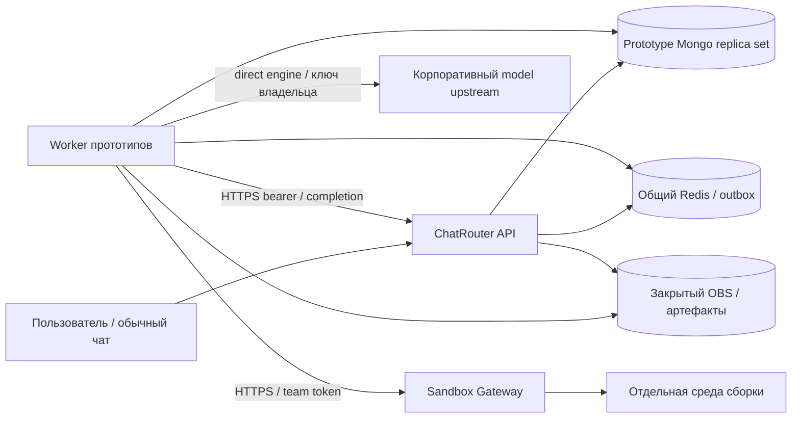

# Сервис прототипов: требования и границы приёмки

Актуализировано 12 октября 2026 года. Это основной контракт; конкретные задачи, результаты и внешние блокеры — [checklist](gateway-migration-tasks.md). Команды запуска — [README](README.md). Старые планы и промежуточные исследования удалены как дубли; они доступны в истории Git и резервной копии очистки.

## Цель и текущая архитектура

Пользователь создаёт прототип в обычном чате: требования → уточнения → план → явное согласование → предпросмотр A/B → правки → выбор варианта → финализация → HTML и ZIP.

Действующий engine — `direct-react-v1`: trusted worker использует выбранную модель и существующий ключ владельца, Gateway отдельно собирает исходник. Будущий `OpenCode/FSD` требует независимой приёмки реального binary/tools/scoped proxy/egress; он не включается переключением worker flags. `release-lock.agent=null`, candidate не принят из-за доступного внешнего egress. Development UI принят; полный production product gate остаётся открытым.



Основная Mongo чата сохраняется. Отдельный prototype replica store — authority заданий/turns/CAS; Redis — транспорт; OBS — immutable исходники и принятые версии. Локальная папка worker — восстанавливаемый cache. Платформой Gateway управляет её оператор, приложение не получает Kubernetes authority.

## Требования

### Функциональные

- [ ] Сохранить frontend flow: понимание требований → необходимые уточнения → видимый план с A/B → явное подтверждение → генерация → preview → дополнительные требования → выбор варианта и финализация → HTML и ZIP. Названия технологий и команды не выводить в продуктовый план.
- [ ] На первом UI milestone сохранить прямой single-file генератор как baseline; после проверки OpenCode перейти к многофайловым FSD source manifests в фиксированном React + TypeScript + `@ai-sber/uikit` шаблоне по требованиям ниже. Модель не выбирает image, runner, argv, env, dependency set, scripts или Gateway configuration.
- [ ] В предпросмотре A/B используют один набор изменяемых данных. Переключение внутри открытого прототипа сохраняет изменения; перезагрузка HTML может вернуть demo-данные. На телефоне доступны формы, действия и переключатель. Финализация удаляет переключатель и сохраняет выбранную компоновку.
- [ ] Встроить узкий Node.js Gateway adapter: create → ожидание → input files → build session → stdout/stderr → exit/result → host-side validation → durable S3/Mongo references → cleanup. Смена local URL/token/CA на production параметры не меняет код адаптера.
- [ ] Реализовать отмену, deadlines, heartbeat, восстановление после restart, повторную доставку команды и неоднозначный исход неидемпотентного запроса согласно разделу о состоянии. Не обещать exactly-once execution.
- [ ] Показывать через существующие чат/SSE безопасные стадии, активность, причины очереди и ошибок, доступные токены/стоимость/время. Raw Gateway metadata и shell output не становятся пользовательским ответом автоматически.
- [ ] Успех сборки требует нулевых exit codes `type-check`, `lint`, production `build`, корректного HTML, ZIP и qaEvidence. Ошибка или неизвестный результат любой проверки запрещает новую публикацию.
- [ ] Подготовить runnable production entrypoint с настоящими generation/build/publish стадиями, service authentication, Mongo/Redis/S3 и восстановлением. Снятие production guards без wiring недостаточно.
- [ ] Сохранить `npm run frontend:dev`, `npm run backend:dev`, `npm run prototype:dev`. `prototype:dev` запускает только сервис прототипов и использует заранее подготовленную платформу. Bootstrap и dependency provisioning выполняются отдельно.
- [ ] Дать первый бесплатный smoke с корректным fixture через реальный Gateway, затем полный обычный чат с реальным провайдером и бюджетом, затем запуск упакованного production сервиса и production control plane с тем же adapter.

### Нефункциональные

- [ ] ChatRouter и prototype service не получают kubeconfig, Kubernetes service-account token, RBAC создания Pod/Job, Docker socket или SSH-ключ платформы. Только bootstrap/operator-tools локального стенда получают доступ к его кластеру.
- [ ] Gateway team token доступен только доверенному prototype service; пользовательский браузер, модель и sandbox его не получают. Mongo, Redis, S3, control-plane private keys, ключи шифрования и provider credentials остаются в прикладном доверенном контуре.
- [ ] Образы и toolchain фиксируются digest/release lock; установка пакетов выполняется при подготовке image, а не при генерации. Пределы input/output/archive/logs и сроков обязательны, fail-closed.
- [ ] При утрате Mongo, S3, Redis, identity или необходимых гарантий платформы остановить admission новых команд; сохранить recovery/cleanup intent. Не выполнять код на host как fallback.
- [ ] Источники, план и принятые результаты переживают удаление sandbox и restart сервиса с пустым локальным cache. Приватность артефактов и права доступа проверяет приложение, а не Gateway labels.
- [ ] Production HTTPS проверяет CA и hostname; запрет `NODE_TLS_REJECT_UNAUTHORIZED=0`, `rejectUnauthorized:false`, redirects с credential forwarding. HTTP допускается только явно выбранным development transport к loopback.
- [ ] Gateway не считать эквивалентом gVisor. Production release блокируется, если не согласована фактическая изоляция root sandbox, сеть, отсутствие внутренних credentials/host mounts и способ подтверждения остановки.
- [ ] Нужен компактный набор контрактных проверок и ручной интеграционный runbook; создание большого набора UI/e2e-тестов генерируемых прототипов не требуется.

## Исполнение и восстановление

### Контракт Gateway

Источники: `gateway/main.go`, `api.go`, `pod.go`, `activity.go`, `teams.go`, `dashboard.go`, `gateway/ui/openapi.json`, `sandboxd/sessions.go`, `group.go`, `clients/python/sandbox_gateway.py`.

Для application operations: `Authorization: Bearer <team token>`; service-generated `X-Request-ID` (1–64 ASCII alphanumeric, `-`, `_`) для корреляции, без пользовательских данных. Этот header не idempotency key. Gateway error обычно `{ "detail": "...", "code": "..." }`, но proxied sandboxd/session errors могут быть plain text или JSON только с `detail`. Клиент сначала учитывает HTTP status/content-type, затем bounded error body; не требует JSON от любого ответа.

| Операция | Запрос | Успешный ответ и особенности |
| --- | --- | --- |
| Версия | `GET /version`, без token | `200 {version:string, api:integer}`. Код клона: API 1, version по умолчанию `dev`, release задаётся build arg VERSION. Перед create требовать согласованный release/API; SDK fallback 404→API1 для этой миграции не использовать |
| Create | `POST /sandboxes`, JSON | `202 {id:string}`; ID сейчас random 16 hex. Не принимает `lease_min`, произвольный Pod spec, requested sandbox ID или session ID |
| Список | `GET /sandboxes?label=k=v&label=k2` | `200` array `{id,team,name?,image,state,reason?,labels?,created_at}`; фильтры AND. Код отдаёт свою team или всё для admin (`sees`), хотя dashboard/look/stats имеют более широкую видимость |
| Статус/renew | `GET /sandboxes/{id}?wait=10` | `200 {id,state,reason}`; состояния `queued`, `starting`, `ready`, `failed`; wait ограничен 0–60 seconds. `own()` продлевает lease. `404` после удаления может содержать время/причину из ограниченной памяти реплики |
| Files upload | `PUT /sandboxes/{id}/files?path=/abs/path`, raw bytes | `204`; создаёт parents через фиксированный `sh`, `cat`. `tar=1` распаковывает tar.gz; не использовать с пользовательским архивом. Для нашего input один bounded JSON, без tar |
| Files download | `GET /sandboxes/{id}/files?path=/abs/path` | `200 application/octet-stream`. `tar=1` directory tar.gz, `tar=auto` probe на GET; в первом релизе скачивать только отдельные известные файлы. Обрыв body означает возможную усечённость |
| Короткий JSON exec | `POST /sandboxes/{id}/run`, `{argv,stdin?,timeout_sec?,env?,cwd?}` | `200 {exit_code,stdout,stderr,timed_out}`; максимум вывода 32 MiB. Ненулевой code — command failure, даже если HTTP 200; timeout описан как kill group и code 124. Output после завершения |
| Binary exec | `POST /sandboxes/{id}/exec` | Body — JSON line `{argv,timeout_sec,env?,cwd?}` + `\n` + stdin. Response — stdout bytes затем stderr bytes, длины `X-Stdout-Length`, `X-Stderr-Length`, status `X-Return-Code`, `X-Timed-Out: 1`. Допускается gzip; это не live stdout stream |
| Session start | `POST /sandboxes/{id}/sessions`, `{argv:string[],env?:object,cwd?:string}` | `201 {id,argv,started_at,running,exit_code}`; `exit_code` nullable, `running` boolean. Нет `timeout_sec`, idempotency, labels или client-supplied id. Фиксированный runner задаёт свой deadline |
| Sessions read | `GET /sandboxes/{id}/sessions`, `GET .../sessions/{sid}` | Array/one Session. State sandboxd хранит в памяти Pod; переживает restart gateway replica, не restart/loss sandboxd |
| Живые логи | `GET .../sessions/{sid}/logs?stream=stdout&offset=N&follow=1` | `200 application/octet-stream`, offset в bytes отдельно для stdout/stderr. Follow заканчивается после завершения leader и чтения файла до конца. Нет SSE frames, cursor header, глобального порядка между потоками или ACK |
| Stdin | `POST .../sessions/{sid}/stdin?close=1`, raw bytes | `204`; stall 30 seconds → `409`. Наш build не требует stdin; source приходит через `/files` |
| Stop session | `DELETE .../sessions/{sid}` | В реальном `sandboxd/sessions.go` **204**, хотя OpenAPI описывает 200. Удаляет запись, убивает group, ждёт leader и удаляет logs. Не вызывать до сохранения нужных logs |
| Diagnostics | `GET /sandboxes/{id}/diagnostics` | `200 {id,team,state,reason,created,pod?,containers?,events?,errors?}`; pod: name/node/phase/reason/message/gated, containers: state/reason/message/exit_code/last_reason/last_exit_code/requests/limits. Частичные ошибки в `errors`. Не renew lease |
| Sandbox delete | `DELETE /sandboxes/{id}` | `200 {id,deleted:true}`, либо 404; delete API Pod c grace=0 и `forget()` происходят без ожидания kubelet termination. Ответ не содержит `writersStopped` |

Create schema: `image` required, nonempty ≤512 characters; `cpus` finite от 0.01 до team max; `memory_mb` positive integer до max; `storage_mb` optional nonnegative, 0/absence → gateway default, bounded team max. Код переводит MB в `Mi` для Kubernetes. Возможны `env`, `compose` (≤16), `compose_env`, `name` ≤253 characters, `labels` ≤16: keys lowercase `[a-z0-9_.-]` с началом/концом alphanumeric, ≤63 characters, values ≤256. Для нас compose отсутствует, env только безопасный fixed allowlist. CPU/memory requests могут отличаться от limits из-за platform fractions; initContainer добавляет requests по LimitRange, что необходимо учесть в local квоте.

Relevant failures:

| Ответ | Поведение адаптера |
| --- | --- |
| `401 invalid_token` | Остановить admission, signal operator; не повторять с бесконечным backoff |
| `400 bad_request`, `422 unprocessable_entity` | Ошибка запроса/образа/лимитов, terminal для текущей попытки; source не публиковать |
| `409 sandbox_not_running` | Сверить sandbox status/diagnostics; bounded ожидание при starting, failure/loss при terminal. Не повторять команду автоматически |
| `404 not_found` | После подтверждённого create возможен informer lag: SDK использует create grace 60 seconds. В этот период повторять GET, не create; затем loss/recovery. Чужой sandbox также 404 |
| Files `400/403/404` | Invalid path/permissions/missing file. Missing result после success session — artifact failure, а не success |
| Session bad request 400, spawn error 422, unknown session 404 | Read bounded body; 404 не доказывает, что session никогда не запускалась |
| `507 insufficient_storage` на `/run` | Вывод превышает лимит; для build sessions/file transport, own limits всё равно обязательны |
| `502 bad_gateway`, `503 service_unavailable`, `504 gateway_timeout`, transport error | Повторяемы GET/DELETE в пределах deadline. Для create/start/exec outcome может быть неизвестен; recovery без слепого POST |
| `429 too_many_requests` | Ограничение транспорта/операции, если встречается; quota ожидание sandbox обычно **202 + queued**, а не 429. Не переносить semantics `/images` на create |

Базовый retry GET/DELETE по SDK: 6 повторов, задержки 0.5, 1, 2, 4, 8, 8 seconds (jitter, ограничение общим deadline). Для log-follow reconnect реализуется у нас. PUT exact input можно повторить только в неподвижной фазе upload, до runner-start, после сверки binding и существующего файла; остальные PUT не объявлять идемпотентными. POST не повторять автоматически. `/images`/BuildKit не требуются первому пути: используем заранее приготовленные images.

Расхождения docs/code фиксируются в client contract: DELETE session 204; Error schema OpenAPI неполна для `code` и proxy errors; общая видимость dashboard не означает доступ чужой team к `/files`. Реальный code `sees` ограничивает own/team/admin; labels не устанавливают app ownership.

### Lifecycle, сроки и лимиты

Предлагаемые начальные значения — часть конфигурации профиля, не production SLO:

| Параметр | Local/pilot default | Правило |
| --- | --- | --- |
| sandbox resources | `cpus: 2`, `memory_mb: 2048`, `storage_mb: 4096` | Explicit create; DevOps согласовывает quota и fractions. Build concurrency 1 для первого прогона, затем ≤2 |
| queue deadline | 120 seconds | Счётчик от create; ограничить максимальную суммарную длительность queued, возвращение в queued его не сбрасывает |
| starting deadline | 360 seconds | Первое наблюдение admitted/starting; включает pull и sandboxd startup. Gateway сам держит transient pull errors до 5 minutes, раньше их отражать как причину ожидания |
| readiness absolute cap | 480 seconds после create | Не позволяет informer лагу/переходам сбросить deadlines |
| runner deadline | 180 seconds total | От session launch, включает workspace preparation, все 3 проверки и упаковку. На одну проверку ≤90 seconds и не больше остатка общего срока |
| artifact collection/persistence | 60 seconds | С bounded retry при сетевых ошибках; отказ storage не разрешает удалить единственную копию результата |
| cancellation confirmation budget | 30 seconds | Затем состояние stop_unknown + durable cleanup, а не объявление writersStopped |
| job/turn deadline | существующие 15 minutes | Любой phase deadline ≤ command.deadlineAt; хранить абсолютные timestamps, restart не обнуляет время |
| model timeout | 300 seconds | Существующий default `localModelTimeoutMs`; configurable bounded, не влияет на Gateway command timeout |
| team lease | 10 minutes | В team config, не create JSON; минимум Gateway 2 minutes. Provider generation выполняется до создания sandbox |
| heartbeat | 20 seconds, ≤lease/6 | `GET /sandboxes/{id}` без observe. Отдельный таймер от logs и тяжёлых команд; track/follow не заменяет явный heartbeat |
| short request timeout | 15 seconds | GET wait=10: response deadline 20 seconds; files ≤30 seconds; follow имеет reconnect interval 20 seconds и ограничен общим deadline |

Не ждать 15 минут на каждый step заново: deadline приходит из принятой команды и переносится дальше существующим pipeline. Платформенный lease и Mongo execution ownership lease — разные механизмы.

Последовательность для build:

1. Перед сетевой мутацией валидировать v2 command и текущий полный tuple в Mongo. CAS owner-claim execution, фиксировать canonical input digest, image/profile, resource limits, deadlines, release/API и create intent nonce.
2. Canonical pipeline input сохранить в S3/ledger **до create**, используя нынешний порядок полей `executionId,profile,format,source`. `input.executionId` по compatibility остаётся `command.commandId`, как в `LocalReactStages`; настоящий `command.executionId` и весь tuple хранятся отдельно в trusted ledger.
3. Один POST create, labels только `tool=chatrouter-prototype`, непрозрачный deployment ID, execution hash и случайный create nonce. Сохранить ID, затем ждать state/reason. Не запускать session, пока Mongo binding не сохранён и status не ready.
4. PUT exact bounded `/run/input/input.json`. При обрыве — GET и digest сверка. Runner ещё не запущен; overwrite разрешён только теми же bytes. Входные поля не преобразуются в shell.
5. Сохранить session-start intent; POST фиксированный argv `['node','/opt/prototype/runner/build.mjs','--input','/run/input/input.json','--output','/run/output','--run', '<opaque-run-nonce>']`, cwd `/opt/prototype/runner`. Все argv кроме validated opaque nonce фиксированы релизом. Nonce — корреляция, не секрет и не авторизация.
6. Сохранить session ID. Независимо читать status, stdout/stderr follow и heartbeat. Runner пишет компактные phase/check markers и обычные readable logs; adapter доверяет markers только в пределах установленной границы доверия, не публикует произвольные JSON-команды из stdout.
7. После `running:false`, exit=0 и подтверждения завершения контролируемых build writers прочитать только `/run/output/result.json`, `preview.html`, `sources.zip`, `qa.json`. Exit !=0 или runner timeout → safe failure/diagnostics. Result нельзя принимать по последней строке stdout.
8. Host-side validation: identity/input/profile/image binding, caps, HTML/ZIP/QA digests, checks и source equality. Сохранить все результаты в immutable S3, перечитать с digest проверкой и CAS зафиксировать trusted receipt. До этого sandbox cleanup не разрешён на успешном пути.
9. Передать stage completion с verified snapshot digest, повторить публикацию уже из durable artifacts на step 5. После durable build receipt sandbox можно удалить; окончательный Mongo publication CAS дополнительно повторяет fence/revision/ownership.
10. Собрать bounded diagnostics до удаления. Удалить session после сохранения logs и sandbox после сохранения outputs. Записать cleanup outcome отдельно от результата продукта.

### Durable state, replay и восстановление

**Решение:** добавить execution model в существующий Mongo контур (`PrototypeExecution`, реализация и приёмка в checklist). Redis registry остаётся быстрым coordination cache; его TTL и `scheduled` не являются единственным доказательством исполнения. Локальные source/snapshot files не являются источником истины.

Запись содержит полный `jobId/turnId/commandId/executionId/attemptId/stage/pipelineStep/expectedRevision/fenceToken`, tenant/user scope, deterministic control-plane leaseId; backend type `sandbox-gateway`; deployment ID; input/profile/template/toolchain/image/runner/architecture digests; Gateway release/API; request nonces; sandboxId/sessionId; intent/sent/ack timestamps; deadlines; state/reason; per-stream raw byte offsets и sanitizer state; artifact/checkpoint/dependency references; completion payload/digest; cancel tombstone; stop evidence; cleanup state и last safe error.

Уникальность по command identity и build launch intent; тот же execution с другим input/profile/image — conflict. CAS связывает updates с полным tuple и service owner epoch. Ownership lease: 60 seconds, renewal каждые 15 seconds; отнимающая lease реплика сначала делает read/reconcile и не запускает mutation с неизвестным прежним исходом. Один replica — стартовый production deployment; record CAS всё равно обязателен для restart/replay.

В Mongo сохранять plan/reason/approval identity, chosenVariant, source checkpoint references, latest accepted source pointer, reservations/usage и связи к turn. Canonical source хранить как immutable bytes в S3, plan/review metadata — Mongo; источник approved plan не выводить из наличия локального файла. Waiting JSON не маскировать под `checkpoint.tar.zst`: source checkpoint — валидный tar.zst с разрешённым TSX; planning checkpoint — явно типизированные plan bytes/metadata, чтение по saved format. Нет source до approval — допустимо.

Время/состояния adapter:

`prepared → create_intent → create_unknown | queued | starting → ready → input_uploaded → session_intent → session_unknown | running → collecting → verified_persisted → stage_reported → cleanup_pending → cleaned`.

Ветви ошибки/отмены: `failed`, `cancel_requested`, `stopping`, `stop_unknown`, `lost`, `quarantined`. Они не добавляют новые публичные job statuses без необходимости. Product review/completed и инфраструктурный cleanup независимы.

| Событие | Обязательная реакция |
| --- | --- |
| Повтор Redis command до launch | Mongo CAS один раз создаёт intent; duplicate присоединяется к execution record. Redis `XAUTOCLAIM` может вернуть живую долгую команду, поэтому проверять Mongo owner lease |
| Restart после create, до сохранения ID | По create nonce + deployment labels найти кандидатов `GET /sandboxes`. Сверить team/image/labels/time с durable intent; без persisted authority labels недостаточны. Один кандидат → bind; несколько → quarantine, остановка/cleanup всех точно принадлежащих этому intent, запрет build |
| Create request оборван, кандидатов нет | Не считать отсутствие в informer доказательством отсутствия Pod; искать до 60 seconds grace. Если результат всё ещё неизвестен — create_unknown, запрет нового POST для этого intent, background reconciliation до исчезновения сирот по lease/подтверждения оператором. Новая пользовательская retry — новая fenced попытка, не повтор старой мутации |
| Restart/обрыв session start до ID | `GET /sandboxes/{id}/sessions`; искать exact fixed argv + opaque run nonce. Один кандидат → bind и читать status/logs; несколько или отсутствие после неизвестного исхода → session_unknown, запрет слепого start, stop/cleanup sandbox и новая explicit attempt после безопасного закрытия прежней |
| Process launched twice из-за сбоя границы HTTP | Дополнительно runner использует exclusive filesystem claim по nonce и inputDigest до build. Второй запуск выходит conflict, не пишет outputs. Это локальный guard в живом Pod, не Gateway idempotency и не гарантия exactly-once |
| Restart во время running | Mongo → sandbox status → session read → продолжение offsets. У нового consumer нет права создавать второй session или обращаться к старой revision |
| Restart после сохранения артефактов | Перечитать S3 и receipt, повторить тот же completion/publication payload. Build не повторяется; cache восстановить в private scratch или передать typed buffers supervisor |
| Mongo принял completion, Redis ACK потерян | Outbox/worker receipts и current tuple показывают уже выполненный переход; ACK duplicate без нового model/create/build. `createdAt` исключается существующим eventDigest; остальные поля при replay обязаны совпадать |
| Redis потерял TTL key | Найти Mongo execution, не объявлять его новым; rebuild registry как cache. Mongo/S3 недоступны → fail-closed |
| Sandbox/session исчезли до durable result | `lost`, диагностика OOM/lease/pull при наличии; не публиковать partial output. Принятая предыдущая версия остаётся доступной. Автоматически платный model request не повторять |
| DELETE потерял ответ | Повторять DELETE bounded, сверять status/diagnostics; отсутствие в registry не доказывает отсутствие процессов. Cleanup intent хранить до подтверждения или operator resolution |
| Input/result conflict | Quarantine, artifact failure, safe message. Не выбирать «первый похожий» sandbox/result |

При частичном S3 upload сохранять progress/intent и повторять immutable puts с digest/owner сверкой. Внутренние checkpoints/dependency bundles/snapshots не становятся публичными артефактами до публикации. Нужно хранить отдельный dependency reference для pipeline: нынешняя таблица public artifacts разрешает только четыре final kinds, а `immutableObjectKey` уже поддерживает `dependency_bundle`.

Retention initial policy: execution tombstones и recovery records минимум 7 дней после terminal и не меньше реального окна transport replay; accepted versions/checkpoints сохраняются по продуктовой политике, не удаляются при Gateway cleanup. Частичные и непринятые objects очищаются после закрытия execution и retention, без удаления ссылок принятой версии. Удаление пользователем задания с revoke доступа — отдельный существующий app cleanup, не sandbox cleanup.

### Отмена, timeout и подтверждение остановки

Контракт: product cancellation в `PrototypeService.changeState` атомарно увеличивает fence/revision, записывает canceled и outbox с прежней execution identity. Cancel command имеет собственный commandId, а target execution tuple относится к прежнему command: lookup должен идти по target execution/attempt/revision/fence, а не только cancel commandId.

**Решение:** независимый прием команд и bounded execution tasks; отдельное Redis connection для blocking reads, для heartbeat/CAS/events — другие connections. Cancel/cleanup/reconcile не стоят за долгим model/build task. При single replica concurrency=1 отмена всё равно обслуживается параллельно. Повторная delivery не увеличивает concurrency и не освобождает чужой claim.

После cancellation CAS:

1. Немедленно запретить новые model/build/upload/publish действия этой identity; abort in-process generation и сбор log streams. При неизвестном provider outcome сохранённая reservation остаётся charged/unknown, автоматического повторного вызова нет.
2. Durable `cancel_requested`, stop intent и target sandbox/session binding. Состояние пользователя уже canceled; техническую остановку ещё не считать подтверждённой.
3. DELETE session, если известна, затем DELETE sandbox независимо от первой ошибки. Не ACK cleanup obligation, пока оно не записано durably. Перед удалением допускается bounded сохранение diagnostics, которое не задерживает отмену бесконечно.
4. Зафиксировать evidence отдельно: runner-managed process groups drained; session leader exit; whole sandbox termination. Эти утверждения не взаимозаменяемы. Таймаут аналогичен cancel, но safe product code `PROTOTYPE_DEADLINE_EXCEEDED`.
5. При неизвестном stop результате — `stop_unknown`, publication ban, ограниченный повтор DELETE и background reconcile. После отказа heartbeat lease помогает cleanup, но не является доказательством уже завершившегося процесса. Статус неопределённости и allocation quarantine не исчезают просто из-за elapsed lease.

**Граница гарантии:** `sandboxd/group.go` посылает SIGKILL process group только пока leader не завершён; `sessions.go` `running:false` — итог leader. Descendants, сохранившие pipe, после grace не препятствуют завершению session. Escape через новую process group и компрометацию root это не исключает. `gateway/main.go:deleteRV` вызывает Pod Delete c grace=0 и сразу `forget`: HTTP 200, последующий GET 404 и отсутствие в list не подтверждают kubelet/cgroup quiescence. Не устанавливать `writersStopped:true` только по этим ответам.

Для нормального успешного build fixed runner обязан держать своих build children до полного завершения, убивать/дожидаться своих групп на ошибке, проверять отсутствие оставшихся build UID процессов до финального результата; сервис хранит этот limited process evidence. Input TSX не исполняется в trusted host, пользовательские scripts/hooks/config не допускаются. После quiescence результат скачивается и проверяется из завершённого controlled build, не из работающего writer.

Для доказательства остановки **всего** sandbox, включая неизвестные процессы, требуется платформенное подтверждение фактического завершения контейнера/cgroup, связанное с sandbox/Pod identity. Существующий Gateway API этого надёжно не предоставляет. Это отдельный DevOps blocker: согласовать внешний operator evidence/эксплуатационный процесс либо платформенное развитие API. Не придумывать endpoint в текущем adapter. В local приёмке operator-only `kubectl` наблюдает точный Pod, container termination и отсутствие workload на живой node; при недоступной node одно исчезновение API object недостаточно. В production application никогда не компенсирует этот gap прямым доступом к Kubernetes.

Неизвестно остановленный sandbox изолировать от publication и новых полномочий; runtime обрабатывает cleanup даже после public canceled. Quota slot не выдавать заново на основании одного DELETE, если физическая остановка остаётся неизвестной. Для production при отсутствии platform evidence закрытие stop_unknown требует оператора; не выдавать ложное подтверждение остановки. Новую fenced пользовательскую попытку можно допустить только при согласованной политике quarantine и наличии отдельной квоты, не возобновляя старые писатели.

Supervisor сейчас требует `writersStopped:true` перед любым outcome, а validator failure допускает лишь три кода. В Gateway runtime разделить **неуспешное завершение продукта** и физический stop: fenced `stage-failures` можно отправить при deadline/loss/artifact/service failure с durable publication ban и cleanup obligation, не подделывая writersStopped. Success/read-result/publication по-прежнему требуют documented quiescence и verified durable receipt. Расширить supervisor failure validation до реально используемых safe codes из v2 (`PROTOTYPE_DEADLINE_EXCEEDED`, `PROTOTYPE_LEASE_LOST`, `PROTOTYPE_ARTIFACT_REJECTED`, `PROTOTYPE_SERVICE_UNAVAILABLE`); cancellation после public CAS не пытается завершать прежнюю revision как актуальную. Unknown infrastructure outcome не включает автоматическую model repair; existing bounded repair pipeline остаётся совместимым, но retryable задаётся только явно разрешённым реальным build failure.

### Toolchain, вход и артефакты

**Решение:** отдельный Docker target `gateway-toolchain` в `apps/prototype-service/Dockerfile`; service `runtime/final` и sandbox image имеют разное назначение. Текущие `runtime/mvp-toolchain` сохраняют ENTRYPOINT `node .../entrypoint.js`, а Gateway сохраняет image ENTRYPOINT и передаёт Args `/.sbx/sandboxd serve`: текущий образ так запускать нельзя. Новый target задаёт exec-compatible ENTRYPOINT `/opt/prototype/toolchain-entrypoint.sh` с `#!/bin/sh` и `exec "$@"`; образ содержит shell/cat/tar для `/files`, node и trusted runner. Gateway принудительно задаёт UID/GID 0: `USER 10001` image этого не отменяет.

Предложение для первого релиза:

- Build runner/supervisor в image, versioned по digest; `/.sbx` reserved Gateway и read-only mount.
- `RUN npm ci` только при image build: фиксированные lockfile и approved base images. Никаких ключей registry/provider в image layers; при необходимости UI Kit registry credential только build secret, с проверкой отсутствия credential/.npmrc в финальном image.
- Dedicated Node 24.16.0 Debian slim base с digest из lock, совместимый с pinned template/compiler; shell/coreutils/tar/zstd/util-linux в toolchain устанавливаются только при сборке image. Service runtime может сохранить собственный Alpine base. Не наследовать тяжёлый Playwright target для frontend build-only. Финальные базовые digests и platform manifests занести в release lock, не заменять на floating latest.
- Template в `/opt/prototype/template`, runner `/opt/prototype/runner`; root-owned control files. Подготовка source workspace `/workspace`, input `/run/input`, output `/run/output`; root writable layer из sandbox Pod допустим только как известная platform property. Build children работают UID/GID 10001 с очищенным env, no-new-privileges и сброшенными доступными capabilities через фиксированный launcher, без writable runner/dependency directories. Это не заменяет платформенную изоляцию root daemon.
- Trusted parent подготавливает workspace, устанавливает ownership writable source/output и запускает команды через fixed `setpriv --reuid=10001 --regid=10001 --clear-groups --bounding-set=-all --no-new-privs -- npm run <fixed-script>` из util-linux. Gateways tokens/DB/S3/model secrets отсутствуют в input/env. Sandboxd per-Pod token `SANDBOXD_TOKEN` действительно наследуется от daemon; не утверждать отсутствие любого токена в Pod. Build-child env собирается allowlist и не включает этот токен. Он отличается от Gateway team token.
- Fixed runner реализует streaming spawn fixed argv для `npm run type-check`, `npm run lint`, `npm run build`; общий deadline, bounded log writes, child lifecycle и atomic final files. Существующий `OfflineBuildQaRunner` использует promisified execFile и буфер, поэтому для live logs требуется streaming path или compatible injected runner. Одного adapter follow недостаточно, если команды молча буферизуют вывод.
- `fixed-template.js` сохраняет проверки контрольных файлов и dependency symlink. Template digest должен покрывать **все** fixed template files, включая main/providers/styles/shared и library compatibility patches, а не только нынешние 8 control files. Lockfile, image manifest digest, runner digest, Node ABI/arch и toolchain digest связываются с доверенным release lock. Нынешний toolchainDigest (node/ABI/platform/arch/lock) не является digest всего image.
- Narrow `repairButtonIcons` и UIKIT_COMPAT_CSS/Tailwind source сохраняются как versioned trusted preparation; модель не получает разрешение на config modification. После preparation hash рассчитывается для фактически применённого fixed template; ZIP обязан совпадать с ним.

CPU architecture определять bootstrap по выбранной Kubernetes node image/platform и `uname -m`. На Apple Silicon предпочтительны native linux/arm64 images для Gateway, sandboxd и toolchain; на amd64 — linux/amd64. Для production amd64 и local arm64: согласованный release source одинаковый, platform-specific digests разные и записаны; либо один OCI multi-arch index с обоими manifest digests. Нельзя использовать Docker image ID/config SHA как pullable OCI digest. Эмуляция amd64 — отдельный явный fallback с большим startup budget, не доказательство производительности production.

Проверки inputs/results:

| Объект | Сохранить/усилить правило |
| --- | --- |
| Model context | ≤1,048,576 bytes history+source+system; дополнительно provider model bounds, output ≤16,384 tokens как текущий max, выбранный бюджет |
| React source | Nonempty ≤200,000 bytes, AST policy `react-source-policy.js`, разрешённые imports, экспорт App и реальный UI Kit JSX; до и внутри sandbox. Dynamic import/require запрещены; AST policy не доказывает сетевую безопасность |
| Pipeline input | `MAX_INPUT_BYTES=220,000`; strict allowed fields. executionId/profile/format validation из `pipeline-contract.js`; canonical digest совпадает с accepted source/command |
| Result envelope | Новый file manifest ≤64 KiB, без base64 artifacts. Сохранить прежний суммарный cap `MAX_RESULT_BYTES=4,000,000` для эквивалентной canonical JSON/base64 envelope: новые raw files не обходят старый лимит, пока отдельное увеличение не согласовано. Проверить размер до чтения каждого файла и cumulative cap во время streaming |
| Runtime stage metadata | result/failure ≤64 KiB, publication ≤128 KiB; сохраняются current supervisor ceilings checkpoint100 MB, dependencies250 MB, html20 MB, sources100 MB, qa5 MB, но более строгий frontend profile cap имеет приоритет |
| Archives | ≤100 MB compressed / 500 MB expanded / 100,000 files / 1,024 bytes path / ratio100 / 60 seconds из existing policy; frontend result cap дополнительно ограничивает. Запрет traversal/absolute/drive/NUL/backslash ambiguity/duplicate normalized paths, symlink/hardlink/devices/FIFO/socket |
| Source ZIP | Доверенный host проверяет entries **до extraction**, original unsafe names до JSZip sanitization, actual App.tsx equality с принятой source bytes, контрольные файлы с release manifest; никаких `.npmrc`, `.env`, `.git`, dependencies/dist/export или чужих inputs. При NUL/duplicate/hardlink ambiguity reject |
| HTML | Полный standalone document, inline resources, отсутствие external scripts/styles/frames/forms/network URL; host-side bounded parser и обязательная CSP в HTML для скачанного offline файла. При CSP normalization digests HTML и qa пересчитываются в trusted service до publication; исходный sandbox digest хранится отдельно |
| Evidence | Host проверяет format и все required checks, exit0/no timeout, exact input/execution/profile + template/toolchain/image/runner binding и html/sources digests. Не доверяет присланному `passed:true` без наблюдаемого build outcome |

Формат qaEvidence сохраняет existing fields:

```json
{
  "schemaVersion": 1,
  "passed": true,
  "validation": "build-only",
  "checks": ["type-check", "lint", "build"],
  "browserQaPerformed": false,
  "consoleErrors": [],
  "networkRequests": [],
  "format": "react",
  "profile": "offline-react-build-v1",
  "executionId": "<pipeline input executionId = commandId>",
  "htmlDigest": "sha256:<hex>",
  "sourcesDigest": "sha256:<hex>",
  "templateDigest": "sha256:<hex>",
  "toolchainDigest": "sha256:<hex>",
  "runtime": "sandbox-gateway"
}
```

`consoleErrors: []` и `networkRequests: []` при `browserQaPerformed:false` — отсутствие browser observations, не доказательство чистой консоли/сети. Дополнительный trusted receipt содержит full tuple, sandbox/session identity, approved image/runner manifest, per-check observed exits, stop evidence, normalized output digests, elapsed timestamps; хранится вне sandbox. Если добавляется его reference в public report — только безопасный непрозрачный ID, без внутреннего objectKey/token.

SHA-256 доказывает совпадение bytes и binding, но не независимую аттестацию. Sandbox с root может изменить свой report, stdout или writable image layer. Trusted runner + host checks повышают уверенность в узком fixed build, не доказывают отсутствие компрометации sandbox. Подписание sandbox report ключом, помещённым в тот же sandbox, не решает проблему. Независимые attestations не входят в релиз; необходимая production isolation assurance — блокер платформы. Сервис не исполняет полученный JS для «проверки» на host.

## Целевой OpenCode/FSD контракт

- [ ] US1: штатные `frontend:dev`/`backend:dev`/`prototype:dev` используют remote Gateway и подготовленные local dependencies без Lima/K3s/bootstrap/второго API. Пользователь проходит plan/approval/A-B/edit/finalize/download из обычного чата. Single-file baseline явно временный.
- [ ] US2: pinned installed OpenCode работает в agent sandbox с моделью, выбранной владельцем в чате через ограниченный Model Proxy; реальные read/search/edit tool turns, многофайловый FSD source, отдельная offline сборка и bounded repair проверены до включения engine пользователям.
- [ ] US3: новая target generation/read/edit/finalize использует accepted full project, обязательные FSD слои и module public APIs по архитектуре `demo-promo-agent`. Общая state/model логика не дублируется между A/B. App.tsx служит композиции, не содержит всю предметную реализацию. One-file HTML экспорт совместим с multi-file sources.
- [ ] Engine фиксируется в job/turn; интерфейс получает approved plan, source manifest, change request, selected model/variant, full tuple, бюджет и limits. Прямая генерация и OpenCode используют один source/build/publication contract; ошибка не переключает engine или модель молча.
- [ ] Agent completion создаёт candidate, не published version. Validation/FSD/import checks и trusted type/lint/build обязательны, затем existing publication/owner CAS. После failure доступна предыдущая accepted версия.
- [ ] Source manifest/checkpoint/plan/approval/engine/model/rules/request receipts сохраняются в Mongo/S3; новая правка после empty-cache restart восстанавливается без живой OpenCode session. Native session portability отдельно проверяется; глобальные auth/config/cache между пользователями не переносить.
- [ ] Legacy single-file HTML/ZIP читаются без пересборки. При явной новой правке допускается конвертация source в FSD как новая версия после checks; existing versions не изменяются.
- [ ] Продуктовый план остаётся понятным пользователю; model/tool/debug/config детали не добавляются в UI. Отдельные стадии/время/известные расходы видны, без обещания точного прогноза.

### Контракт source и ограничения runtime

Source profile versioned отдельно от `offline-react-build-v1`. Manifest фиксирует schemaVersion, sorted relative file paths, bytes/hash, aggregate digest, rules/template/toolchain pins; strict validation и полный source/ZIP/config equality заменяют single App.tsx equality на target profile. Старый контракт не расширяется бесконтрольно.

Разрешены `.ts/.tsx/.css` только в allowlisted source slots. Запрещены absolute/traversal/NUL/duplicate/symlink/hardlink paths, binary inputs, config/dependency/runner/OpenCode plugin изменения и внешние imports. Fixed main/providers/globals защищены либо меняются в явно описанных trusted slots. FSD импортирует вниз app→pages→widgets→features→entities→shared, межслайсовые imports через public index; aliases разрешены только внутри source root. Проверки архитектуры не ограничиваются наличием папок.

Стартовые configurable caps: 500 source files, 256KiB/file, 5MiB source, 20MiB expanded source archive, 5MiB source ZIP, 3MiB HTML; transport/base64 overhead учитывается отдельно. Fixed dependencies устанавливаются при trusted image preparation; модель не меняет package/lock/scripts/build config. Произвольная установка зависимостей не входит в релиз.

Agent и build — разные sandbox executions. OpenCode может читать/искать/редактировать разрешённые источники; arbitrary bash, webfetch, external directories, MCP/plugins/subagents/dev servers и изменение собственного config запрещены. Trusted wrapper выполняет checks; repair receives bounded safe diagnostics, до2 rounds после initial build. Проверка настоящего binary обязательна: старый broad `localAutoApprove` не годится для target runtime.

Правила `demo-promo-agent` копируются и версионируются внутри ChatRouter, не импортируются из sibling repository при запуске. React/TS/UI Kit/FSD/A-B/approval сохраняются, но instructions об npm install, external Storybook MCP, MSW network и внешних preview hosting адаптируются к fixed/offline product profile. Экспортированный HTML не требует Service Worker/backend/внешних запросов.

### Model access, бюджет и восстановление

Agent sandbox получает только короткоживущий scoped Model Proxy token с user/model/job/turn/attempt/fence/lease binding. Upstream provider key, Gateway team token, Mongo/Redis/S3/mTLS secrets остаются trusted side. Ротация token, revoke/expiry/active lease проверяются на каждом model request. Output ZIP/logs не содержат credential/config material.

Из remote sandbox должен реально открываться согласованный HTTPS Model Proxy; ноутбучный loopback не подходит. Owner маршрута/egress — входное условие. Отсутствующий route блокирует real agent evidence; запрещён обход с provider key или запуск OpenCode на trusted host. Build sandbox не получает model authority и остаётся offline.

Проверить exact SDK/binary/provider streaming tools/usage/discovery protocol с выбранной моделью, выбранной владельцем в чате. Наличие обычной chat completion в acceptance не доказывает tool compatibility. Начальная pinned SDK/binary версия в repo1.18.16 — input исследования, не гарантия работающего образа.

Стартовые acceptance limits: $2/turn, до8 provider requests/100 tools/2 repair rounds/10min total, build180s. Deadline относится к активному generation/repair и всем его checks, а не к ожиданию approval/review. Все calls/repairs используют общий persisted budget с уникальными request IDs; старый «один code request на command» контракт должен поддержать agent loop. Unknown upstream response/cost не вызывает blind replay; отмена отнимает новые полномочия, но не обещает отсутствие стоимости уже начатого запроса.

## Запуск и идентификация

- Development: root `.env`, подготовленные зависимости, `frontend:dev` / `backend:dev` / `prototype:dev`; launcher не создаёт кластер и не копирует аккаунты. Preview origin хранится в YAML.
- Production: standalone image и `node apps/prototype-service/src/entrypoint.js`, `NODE_ENV=production`, роль orchestrator/backend sandbox-gateway. Root `.env` и development identity profile не используются.
- Первый deployment использует существующий HTTPS ingress и отдельный bearer `PROTOTYPE_SERVICE_TOKEN`. API проверяет HTTPS и tuple. Optional native mTLS реализован и проверен отдельно; первая выкладка не требует PKI. RSA signing key scoped token находится только в API.
- Пути: `/api/internal/prototype-tokens/refresh`, `/api/internal/prototype-control/v2/*`, `/api/prototype-model/v1/*`. Service bearer не заменяет scoped model token; token ≤45s, привязан к owner/model/job/turn/attempt/fence/lease и живому состоянию store.
- Общие настройки: `AWS_*` с явным region/addressing, `REDIS_URI`, `OPENROUTER_API_URL`; никаких вторых наборов prototype S3/Redis/provider credentials. API и worker используют один prototype URI, общий Redis/OBS и существующие CREDS_KEY/IV. Worker читает ключ модели владельца из primary store; RSA/JWT ему не нужны.
- Secret получателей раздельные, защищённый источник общих значений один. Существующие ключи шифрования нельзя произвольно менять. Перенос исторических значений из tracked YAML требует согласованной доставки Secret без потери доступа к зашифрованным записям.
- Инструмент доступен для новой генерации авторизованным пользователям при включённой функции; owner-bound reads/cancel сохраняются. Capability требует transport readiness и свежего authenticated heartbeat. Отказ worker скрывает инструмент, сохраняет draft и не запускает обычную отправку автоматически. Обычные API startup/login/chat независимы от optional worker; это не обещание независимости от общих Mongo/Redis/OBS.
- Standby: intake=false, healthz200, application readyz503, нет queue ACK/heartbeat/model POST. Active: intake=true, dependencies/storage/heartbeat проверены; readyz200. Chart выбирает readiness в соответствии с режимом.

## Приёмка, rollout и эксплуатация

1. Gate UI: T001–T006/T037, настоящий обычный чат и browser acceptance с direct baseline; development identity явно отмечена.
2. Gate O: T007–T017, installed OpenCode tools/proxy/permissions, multi-file FSD, repair, измеренная стоимость/время/качество. По одному sample не обещать экономию.
3. Gate FSD: T018–T025, полный project restore после empty-cache restart, edit/phone/finalizeB, offline HTML/ZIP; старые версии читаются без пересборки.
4. Gate P: T026–T036, packaged runtime/service identity, cancel/replay/unknown/S3/restart, actual platform isolation/egress/stop и CI/registry/rollout. Исходники и локальный smoke не закрывают production acceptance.

Стартовая S3 quota30GB; alerts70/85/95%, запрет admission при95% или нехватке зарезервированной ёмкости. Unknown capacity fail-closed. Ref-aware GC защищает accepted/active/recovery refs; staging24h и unreferenced failed drafts7дней — предложения для согласования, finals без auto-expiry. Tombstones≥7дней и actual replay window. Backups/noncurrent versions/registry retention учитываются отдельно.

DevOps/Gateway inputs: фактические release/API/images/architectures, HTTPS/DNS/CA/routes, team non-admin identity и rotation, quotas/lease/queue, stable image retention/pulls, nonroot/security context/default-deny network и запрет host/metadata/DB доступа, whole workload stop evidence, Mongo replica/ACL/backup, Redis persistence/noeviction, OBS capabilities/capacity, dedicated Secrets, CSI/PVC, logs/metrics и rollback ownership. Unknown inputs записываются блокерами; независимая локальная работа продолжается.

Порядок: бесплатный fixture/probe → согласованный owner/model/scope/budget → реальная генерация → packaged product acceptance → production deployment. Production store writes и платные calls требуют явного согласования конкретного scope; unknown POST outcome сначала reconcile, автоматического повтора нет. Не подменять real provider/browser acceptance тестами и не выводить keys/headers/URI в evidence.

Откат: остановить intake/admission, fence/cancel и reconcile исполнения, сохранить Mongo/OBS/Secrets, вернуть предыдущий image/config. Host/legacy fallback запрещён. Accepted versions не переписываются, cleanup известных собственных ресурсов не удаляет общие данные. Полный стоп процесса подтверждается платформой отдельно от DELETE ACK/GET404.

Основные runtime точки: `runtime-factory.js`, `react-stages.js`, `gateway-pipeline-client.js`, `gateway-execution-repository.js`, `durable-stage-workspace.js`, `sandbox-gateway-client.js`; contracts — `packages/prototype-worker/src/contracts.v2.ts`, API schemas и [contracts-v2](contracts-v2.md). Images/profiles — `apps/prototype-service/deploy/gateway/release-lock.json`; deployment — `helm/prototype-service`, `envs/prod-prototype-worker.yaml`, `.gitlab/prototype-service.yml`.
